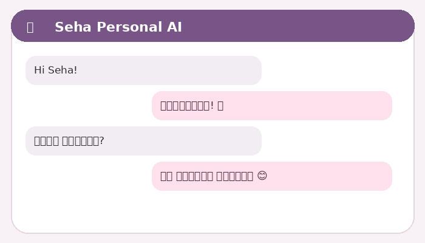

<div align="center">


<a href="https://imgbb.com/">
  
</a>

# 🌸 Seha Personal AI

**A warm, private WhatsApp chat companion — powered by Gemini, with Groq fallback.**


[සිංහල උපදෙස්](README_SI.md) · [Features](#features) · [Kaggle setup](#run-on-kaggle) · [Commands](#commands)



</div>

---

## What is Seha?

Seha is a personal WhatsApp chat companion with a gentle, friendly character. It supports Sinhala and English, uses Gemini as the primary AI provider, and calls Groq only when Gemini fails. It is designed to run inside a Kaggle notebook. The project pins Baileys 6.7.24 (legacy stable line) to avoid the breaking API changes in the 7.0 release-candidate line.

> **Important:** This project uses Baileys, an unofficial WhatsApp Web integration. It is not the official WhatsApp Business Platform. Use a separate test number, avoid bulk messaging, and understand that unofficial automation may carry account restrictions or logout risk.

## Features

- **Natural chat:** no stored chat history; each AI request includes only the current message, Seha's persona, language setting, and a few relevant profile facts.
- **Automatic profile notes:** stores a contact's display name by default, and updates name/age/location only when the person explicitly shares first-person details.
- **GitHub JSON storage:** optional read/write sync to `database/users.json` and `database/settings.json` in your private repository. Writes happen only when a profile or setting changes.
- **Owner controls:** private chats, groups, owner-only mode, welcome message, global reply language, and status.
- **Media tools:** create a static WebP sticker from a replied image; convert replied audio/video to MP3; convert replied video to MP4.
- **Pairing code:** connect by the eight-digit phone-number pairing code instead of scanning a QR.

## Project structure

```text
Seha-Personal-AI/
├── assets/                 # Avatar and animated README demo
├── config/persona.js       # Seha's character instructions
├── database/               # Initial empty JSON database files
├── docs/                   # Privacy and usage notes
├── kaggle/                 # Ready-to-edit Kaggle notebook
├── src/
│   ├── ai.js               # Gemini primary + Groq fallback
│   ├── commands.js         # User and owner commands
│   ├── config.js            # Reads Kaggle environment variables
│   ├── database.js          # Local + GitHub JSON storage
│   ├── main.js              # Application entry point
│   ├── media.js             # Sticker / MP3 / MP4 processing
│   ├── profile.js           # Minimal profile extraction
│   └── whatsapp.js          # Baileys connection and message handler
├── tests/                   # Basic profile tests
├── package.json
├── README.md
└── README_SI.md
```

## Run on Kaggle

### 1. Create a private GitHub repository

Create a new repository named `Seha-Personal-AI` and set it to **Private**. Upload the contents of this project ZIP to the repository (upload the files inside the folder, not the ZIP itself).

For GitHub database sync, create a fine-grained Personal Access Token with access to only this repository and **Contents: Read and write** permission. The token is entered only in the Kaggle notebook cell; it is not included in this project.

### 2. Open the included notebook

Open `kaggle/Seha_Kaggle_Setup.ipynb` in Kaggle, then edit the configuration cell. Add:

- Owner WhatsApp number (digits only, including country code, e.g. `9477XXXXXXX`)
- WhatsApp number to link (can be the same number)
- Gemini API key
- Groq API key (optional fallback)
- GitHub owner, repository, and token (for persistent JSON storage)

The project source, README, ZIP, and default JSON files contain **no real keys, phone numbers, tokens, or WhatsApp session credentials**.

### 3. Run the cells in order

The notebook installs Node.js 22 and FFmpeg, downloads your private repository, installs packages, creates a Kaggle-only auth folder, and starts Seha. When the eight-digit code appears:

1. Open WhatsApp on the phone number you entered.
2. Go to **Settings → Linked Devices → Link a Device**.
3. Choose **Link with phone number instead**.
4. Enter the code printed in Kaggle.

Do not share the notebook after entering keys. Do not commit the Kaggle notebook with actual keys in it.

### 4. Keep it connected

Kaggle sessions are temporary. When a session ends, start the notebook again. This project deliberately does **not** upload WhatsApp auth credentials to GitHub. If Kaggle storage is reset, you may need to pair again.

## Commands

| Command | What it does |
|---|---|
| `.list` | Sends Seha avatar and the command list |
| `.sticker` | Reply to an image with `.sticker` to make a WebP sticker |
| `.mp3` | Reply to audio/video with `.mp3` to extract MP3 audio |
| `.mp4` | Reply to a video with `.mp4` to convert it to MP4 |
| `.forgetme` | Deletes your saved profile from the JSON database |

### Owner-only commands

| Command | Effect |
|---|---|
| `.owner private on` / `off` | Enable/disable private chats |
| `.owner groups on` / `off` | Enable/disable group chats (OFF by default) |
| `.owner onlyme on` / `off` | Allow only the owner to use Seha |
| `.owner welcome on` / `off` | Enable/disable first-contact welcome |
| `.owner language sinhala` | Set every reply to Sinhala |
| `.owner language english` | Set every reply to English |
| `.owner language auto` | Reply in the language of the latest message |
| `.owner status` | Show current settings |

Owner commands are authenticated using the sender's WhatsApp number, not their display name. `.owner onlyme on` does not block the owner's own commands.

## Privacy and data

- No full chat history is saved or sent to the AI provider.
- A compact profile may contain WhatsApp ID, display name, chosen name, age, and location/from-where if explicitly shared by that contact.
- `.forgetme` deletes the sender's profile.
- GitHub sync is optional. Without a GitHub token, data stays in the Kaggle session's local `database/` folder and may be lost when the session ends.
- Use a **private** repository. A private GitHub database is still personal data; protect repository access and tokens.
- The WhatsApp pairing session stays under the Kaggle working directory and is excluded by `.gitignore`.

Read [docs/PRIVACY.md](docs/PRIVACY.md) before using it with other people's chats.

## Media command limits

These commands process media that is already sent to the bot or quoted in the current chat. They do not scrape or download from YouTube, TikTok, Instagram, or Facebook. Only convert files you own or have permission to use. Input files are capped at 25 MB; output files are capped by `MAX_MEDIA_MB` (15 MB by default).

## Troubleshooting

- **Node version error:** rerun the notebook's first setup cell; Baileys requires a modern Node.js runtime.
- **No pairing code:** check `WHATSAPP_NUMBER` includes country code and digits only. Wait for the connection event. If already registered in the current auth folder, no new code is needed.
- **Gemini failed:** check your API key and current model availability. Groq is used only if a Groq key is configured and Gemini fails.
- **GitHub sync fails:** confirm the repository is private, owner/repo names are correct, and the token has Contents read/write access.
- **Media conversion fails:** check that the notebook installed FFmpeg and that you replied to the correct media type.

## Current project boundary

This is a complete test-project implementation for a single personal instance, not a production-grade multi-user service. Baileys is unofficial and can break when WhatsApp changes its web protocol. For commercial or business-critical use, use the official WhatsApp Business Platform and its approved APIs.

## License

MIT — see [LICENSE](LICENSE).
