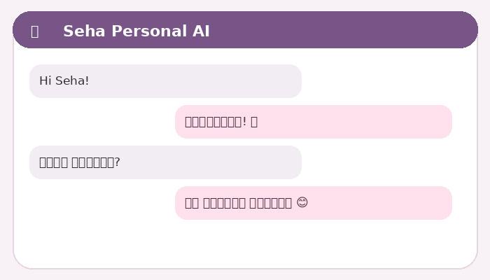

<div align="center">


<a href="https://imgbb.com/">
  
</a>

# 🌸 Seha Personal AI

**A warm, private WhatsApp chat companion — powered by Gemini, with Groq fallback.**


[සිංහල උපදෙස්](README_SI.md) · [Features](#features) · [Kaggle setup](#run-on-kaggle) · [Commands](#commands)



</div>

# 🌸 Seha Personal AI — සිංහල මාර්ගෝපදේශය

**Kaggle එකෙන් run කරන පුද්ගලික WhatsApp AI chat companion එක.**

</div>

## මේ project එකෙන් මොනවාද වෙන්නේ?

Seha කියන්නේ Sinhala/English දෙකෙන්ම ස්වභාවිකව කතා කරන WhatsApp bot එකක්. Gemini primary AI එක. Gemini එක fail වුණොත් විතරක් Groq fallback එක භාවිතා කරනවා. Chat history එක save කරන්නේ නැහැ. User තමන් ගැන පැහැදිලිව කියන නම/වයස/ප්‍රදේශය වගේ කුඩා profile facts විතරයි save කරන්නේ. Baileys 6.7.24 API line එක pin කරලා තියෙන්නේ v7 release-candidate එකේ breaking changes වළක්වන්න.

**වැදගත්:** Baileys කියන්නේ unofficial WhatsApp Web library එකක්. WhatsApp එකේ official Business API එකක් නෙවෙයි. Separate test number එකක් භාවිතා කරන්න. Spam/bulk messaging කරන්න එපා. Account logout/restriction risk එකක් තියෙන්න පුළුවන්.

## පියවර 1 — ZIP එක download කරලා GitHub එකට දාන්න

1. `Seha-Personal-AI.zip` extract කරන්න.
2. GitHub එකට ගිහින් `New repository` තෝරන්න.
3. Repository name එක `Seha-Personal-AI` දෙන්න.
4. **Private** තෝරන්න.
5. Extract කළ folder එක ඇතුළේ තියෙන files GitHub repository එකට upload කරන්න.
6. ZIP file එකම upload කරන්න එපා; ZIP එක ඇතුළේ තියෙන files/folders upload කරන්න.

GitHub JSON database එකත් use කරනවා නම්, ඒ repository එකට පමණක් access තියෙන Fine-grained Personal Access Token එකක් හදන්න. `Contents: Read and write` permission දෙන්න. Token එක notebook cell එකට දාන්න; source code එකට හෝ GitHub එකට දාන්න එපා.

## පියවර 2 — Kaggle notebook එක open කරන්න

Project එකේ `kaggle/Seha_Kaggle_Setup.ipynb` file එක Kaggle notebook එකක් විදිහට open කරන්න. Notebook එකේ CONFIGURATION කියන cell එකේ values වෙනස් කරන්න:

- `OWNER_NUMBER`: bot එකේ owner ගේ WhatsApp number එක. Country code එකත් එක්ක digits පමණක්.
- `WHATSAPP_NUMBER`: WhatsApp එකට link කරන්න ඕන number එක. Owner number එකම නම් ඒකම දාන්න.
- `GEMINI_API_KEY`: Gemini API key එක.
- `GROQ_API_KEY`: fallback key එක. නැත්නම් හිස්ව තබන්න.
- `GITHUB_OWNER`: GitHub username එක.
- `GITHUB_REPO`: repository name එක.
- `GITHUB_TOKEN`: GitHub token එක. GitHub database sync ඕන නැත්නම් හිස්ව තබන්න.

**මේ project ZIP එක තුළ කිසිම සැබෑ API key, phone number, GitHub token හෝ WhatsApp session එකක් නැහැ.** ඔයාගේ values Kaggle notebook cell එකේම දාන්න.

## පියවර 3 — Notebook cells එකින් එක run කරන්න

1. පළමු cell එක Node.js 22 සහ FFmpeg install කරනවා.
2. ඊළඟ cell එක GitHub repo එක download කරනවා.
3. ඊළඟ cell එක npm packages install කරනවා.
4. අවසාන cell එක Seha start කරනවා.

Kaggle output එකේ ඉලක්කම් 8ක pairing code එකක් එනවා. Phone එකේ:

**WhatsApp → Settings → Linked Devices → Link a Device → Link with phone number instead**

ඊට පස්සේ Kaggle එකේ පෙන්වන code එක ඇතුළත් කරන්න.

## Commands

| Command | වැඩේ |
|---|---|
| `.list` | Seha avatar එක සහ command list එක යවනවා |
| `.sticker` | Image එකකට reply කරලා `.sticker` යැව්වොත් sticker එකක් හදනවා |
| `.mp3` | Audio/video එකකට reply කරලා MP3 බවට convert කරනවා |
| `.mp4` | Video එකකට reply කරලා MP4 බවට convert කරනවා |
| `.forgetme` | ඔයාගේ saved profile එක මකනවා |

### Owner විතරක් භාවිතා කරන commands

```text
.owner private on
.owner private off
.owner groups on
.owner groups off
.owner onlyme on
.owner onlyme off
.owner welcome on
.owner welcome off
.owner language sinhala
.owner language english
.owner language auto
.owner status
```

`language` setting එක සියලුම chats වලට බලපානවා. `auto` කියන්නේ අනිත් කෙනා message එක දාපු භාෂාවෙන් reply කරන එක.

## Profile එක save වෙන්නේ කොහොමද?

- පළමු වතාවට message එකක් එව්වම WhatsApp display name එක profile name එක විදිහට ගන්නවා.
- කෙනෙක් තමන්ගේ නම, වයස, හෝ ඉන්න ප්‍රදේශය පැහැදිලිව කිව්වොත් ඒවා update කරනවා.
- වෙනත් කෙනෙක් ගැන කියන තොරතුරු profile එකට දාන්නේ නැහැ.
- Chat messages / history එක save කරන්නේ නැහැ.
- `.forgetme` යැව්වොත් ඔයාගේ profile එක මකනවා.

## GitHub database එක

GitHub sync එක active වෙන්නේ `GITHUB_OWNER`, `GITHUB_REPO`, `GITHUB_TOKEN` තුනම ලබා දුන්නොත් විතරයි. එවිට profile/settings වෙනස් වුණාම පමණක් `database/users.json` හෝ `database/settings.json` update වෙනවා. Token එකක් නැත්නම් Kaggle session එකේ local database එක පමණක් භාවිතා වෙනවා; session එක අවසන් වුණාම ඒ data නැතිවෙන්න පුළුවන්.

## Kaggle session එක අවසන් වුණොත්?

Kaggle session එක ස්ථිර server එකක් නෙවෙයි. Session එක stop/expire වුණොත් notebook එක නැවත run කරන්න වෙනවා. WhatsApp session credentials GitHub එකට upload නොකරන නිසා Kaggle working storage එක reset වුණොත් නැවත pairing කරන්න සිදුවිය හැකියි.

## Media ගැන සීමාව

`.sticker`, `.mp3`, `.mp4` commands WhatsApp chat එකට upload කළ හෝ reply කළ media file එක process කරනවා. YouTube, TikTok, Instagram, Facebook වලින් videos scrape/download කරන code එකක් මෙහි නැහැ. ඔයාට අයිතිය හෝ අවසර ඇති files පමණක් convert කරන්න. Input limit 25 MB; output limit default 15 MB.

## දැනගත යුතු සීමාවන්

මේක single personal test project එකක්. Production service එකක් නෙවෙයි. Baileys unofficial නිසා WhatsApp protocol වෙනස් වුණොත් bot එක කැඩෙන්න පුළුවන්. Business-critical/production භාවිතයට official WhatsApp Business Platform භාවිතා කරන්න.
